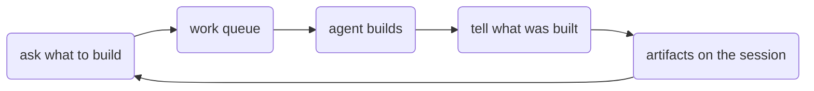

# Work plugins

Work plugins power the **BuildAutomaton** blank surface and queue. They live under `plugins/src/work/` — not named after the repo. `coreSet()` installs the node set.

You describe a problem, or the solution you want. An agent picks that up, builds it from open source components, and comes back with a summary. The agents and models are whichever ones you hook up. ACP sessions still run. The chat popup is not part of the app.

It plugs into both runtimes:

- [Runtime plugins](./runtime.md) — queue, artifacts, and tools
- [UI plugins](./ui.md) — the prompt screen

[Local CLI](../local-cli/) (`app` mode) and [app-host](../app-host/) already compose those plugins.



The [local CLI](../local-cli/) opens a blank screen with a prompt. Submitting it morphs that screen into the app, with the runtime as the backend. App widgets, the data store, and workflows are separate plugins, not part of this set.

## Quick wire-up

```ts
import {
  createRuntime,
  coreSet,
  appPlugin,
  securityPlugin,
  dataStorePlugin,
  workflowsPlugin,
  widgetsPlugin,
  externalMcpPlugin,
} from '@buildautomaton/plugins';

const runtime = { cwd: process.cwd(), log: console.error };
await createRuntime({
  cwd: process.cwd(),
  plugins: [
    ...coreSet({ options: { cwd: process.cwd() }, runtime }),
    appPlugin({ runtime }),
    securityPlugin({ runtime, options: { workspaceId: process.cwd() } }),
    dataStorePlugin({ runtime, options: { workspaceId: process.cwd() } }),
    workflowsPlugin({ runtime }),
    widgetsPlugin({ runtime }),
    externalMcpPlugin({ runtime }),
  ],
});
```
